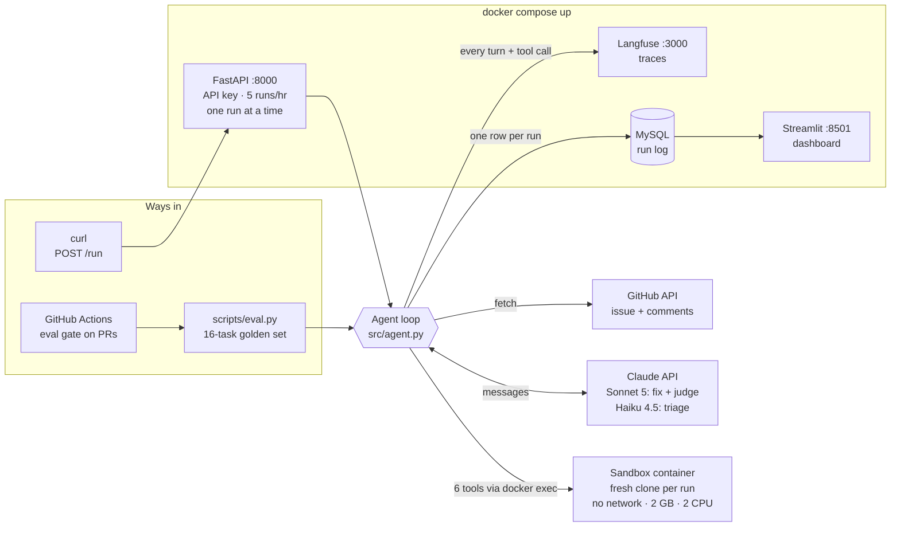
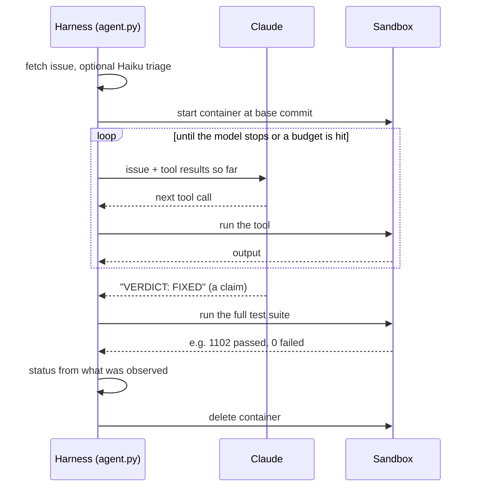

# GreenChecker

*An autonomous GitHub issue-fixing agent that only ships a patch when the tests go green.*

**Resolves ~90% (14/16) of real closed issues from [pyupgrade](https://github.com/asottile/pyupgrade) at $0.31 per fix and a 73s median**, scored not by its own say-so but by whether the maintainer's actual test suite passes.

Runs locally — `docker compose up` and a `POST /run` away. No hosted demo; deployment was deliberately deferred (see [Status](#status)).

---

## What it does

Give it a GitHub issue URL. It clones the repo into a disposable container, investigates with a fixed toolset, writes a patch, runs the real test suite, and returns a structured result. It opens nothing and claims nothing it hasn't executed.

```bash
curl -X POST localhost:8000/run \
  -H "X-API-Key: $TRIAGE_API_KEY" \
  -d '{"issue_url":"https://github.com/asottile/pyupgrade/issues/804"}'
```

```json
{
  "issue_id": "asottile/pyupgrade#804",
  "status": "fixed",
  "tool_call_count": 11,
  "duration_seconds": 66.9,
  "cost_usd": 0.102252,
  "tests_passed": 1096,
  "tests_failed": 0,
  "files_changed": ["pyupgrade/_plugins/typing_classes.py",
                    "tests/features/typing_classes_test.py"],
  "trace_url": "http://localhost:3000/project/repo-triage-agent/traces/dd3368..."
}
```

That example is real output. #804 had been open since 2023.

---

## Architecture



There are three ways to start a run. All three call the same function,
`run_issue()`, so a fix made through the API is produced and checked the same
way as one in the eval or in CI.

| Component | Role |
|---|---|
| **API** ([src/api.py](src/api.py)) | Takes an issue URL and returns a structured result. Requires an API key, allows 5 runs per hour and one run at a time, because each request starts a container and spends money. |
| **Agent loop** ([src/agent.py](src/agent.py)) | Written directly against the Anthropic SDK, with no orchestration framework, so every budget check and stopping condition is in one file. The model chooses what to try; the harness enforces the limits and decides the outcome. |
| **Sandbox** ([src/sandbox.py](src/sandbox.py)) | A fresh container per issue, checked out at the issue's base commit, with networking off. Six tools run inside it: `read_file`, `grep_code`, `write_file`, `apply_patch`, `run_tests`, `git_diff`. The container is deleted when the run ends. |
| **Claude** ([src/llm.py](src/llm.py)) | Sonnet 5 writes the fix and judges diffs. Haiku 4.5 runs the optional pre-check (triage) that turns down issues it can't fix. |
| **Langfuse** ([src/tracing.py](src/tracing.py)) | Records every model turn and tool call, so a failed run can be replayed step by step. Optional: with tracing off, the agent behaves identically. |
| **MySQL** ([src/store.py](src/store.py)) | One row per run: status, cost, duration, tool calls, judge score, trace link. Falls back to SQLite when `DATABASE_URL` is unset, so CI and a fresh checkout need no database. |
| **Dashboard** ([scripts/dashboard.py](scripts/dashboard.py)) | Reads the run log and shows resolve rate, cost per fix, latency, and where spend went. |

The API container doesn't run sandboxes itself. It drives the host's Docker
through the mounted socket and starts one container per issue. That is why the
API requires a key and shouldn't be reachable from an untrusted network.

### One run



**Enforced by the harness, not requested of the model:** 15 tool calls per issue,
a 5-minute wall clock, and 3 failed test runs before it stops. The model ends
with a `VERDICT:` line, but that is treated as a *claim* — the harness re-runs
the suite itself and decides the status from what it observes.

### Scoring

Three axes, deliberately not averaged together:

| Axis | Kind | Catches |
|---|---|---|
| Suite green | execution | nothing works |
| **Upstream test oracle** | execution | a fix that satisfies the agent's own test but not the maintainer's |
| LLM judge (0–3) | opinion | symptom-suppression and test-weakening that passes both above |

A task counts as **resolved** only when the maintainer's own tests pass, the
full suite is green, and no existing test was weakened. The judge score is
reported alongside and never folded into the pass rate — averaging an execution
result with a model's opinion produces a number that means nothing.

The 16-task golden set is built from merged-PR linkage (11 API requests for 48
issue↔PR pairs) and then **verified before use**: 13 of 29 candidates were
dropped because their base commit was red, they had no test, or their upstream
test passed at base. Each survivor has a green base and a ground-truth test that
provably fails there.

---

## What broke and how I fixed it

**1. Every byte the agent wrote into the container was corrupted.**
Python's `subprocess` text mode performs newline translation on *stdin* on
Windows, silently turning every `\n` into `\r\n` inside a Linux container. That
corrupted every unified diff handed to `git apply` and wrote CRLF `.py` files.
Fixed by moving the host boundary to bytes ([sandbox.py](src/sandbox.py)).
**Before: patches rejected with an invisible `^M`. After: 0 CR bytes**, with a
permanent regression check in the smoke test.

**2. `git apply` rejects the diff shape LLMs actually emit.**
After the CRLF fix, a byte-identical hand-written patch *still* failed. Isolated
to a rule with a 5-case matrix:

| hunk shape | result |
|---|---|
| 1 context line, insert at end of hunk | rejected |
| 3 context lines, insert at end of hunk | rejected |
| 1 context line **+ 1 trailing context line** | applies |

Any hunk ending on a `+` line with no trailing context is refused, and
`--recount` cannot repair it. `apply_patch` became a three-rung ladder
(`git apply` → `--recount` → GNU `patch --fuzz=2`) that reports which rung
fired. **Worth doing because a rejected patch costs 1/15 of the budget** — and
traces later showed a single run burning 2 calls on exactly this.

**3. The eval was lying in both directions.**
The first grading gate used the agent's *own* test to certify a fix. Replacing
it with the maintainer's test — the standard SWE-bench criterion — moved the
score **9/16 → 8/16** and changed *five* verdicts: two fixes had been wrongly
failed by harness bugs, and **three were false positives** where the agent wrote
a test its own fix satisfied while the required behaviour went unmet. A fourth,
#848, had **deleted an existing test** rather than make it pass — invisible to
every execution check, caught only by the judge. Re-grading every past run cost
**$0**, because scoring is separated from execution.

<sub>Also found and fixed: a prompt rule telling the agent to skip "feature
requests" while every golden task was actionable by construction (#1054 went
skipped → fixed); a `.rej` file from the fuzzy patcher polluting `git_diff` and
failing a real fix; and a `find .` over `.git` that turned a working patch into
a 60s timeout.</sub>

---

## Cost and latency

From the run log (24 runs, [dashboard](scripts/dashboard.py)):

| stop reason | runs | resolved | mean cost | mean calls |
|---|---|---|---|---|
| `model_finished` | 15 | 12 (80%) | $0.125 | 10.5 |
| `tool_budget_exhausted` | 9 | 3 (33%) | $0.195 | 15.0 |

**43% of all spend went to runs that resolved nothing.** Budget-exhausted runs
cost 56% *more* and resolve 47 points *less*.

The optimization built against that: a ~$0.002 Haiku triage call that declines
hopeless issues before the expensive loop starts.

- **On the golden set: 0 declined, +1.2% cost — a negative result.** The golden
  set is filtered to issues a maintainer actually fixed, so every one is
  actionable and the gate has nothing to catch.
- **On the real open-issue stream (n=15): −5.4% cost, −6.7% latency**, declining
  1 issue — correctly, a "what's the rationale for this design" discussion.

Tuned to decline only at confidence ≥ 0.8, because the errors are asymmetric: a
wrong decline forfeits a fix permanently, a wrong attempt wastes twenty cents.

---

## Setup

Requires Docker and an Anthropic API key.

```bash
git clone https://github.com/dattang12/GreenChecker.git && cd GreenChecker
cp .env.example .env
# In .env, set:
#   ANTHROPIC_API_KEY   (+ ANTHROPIC_WORKSPACE_ID if the key is identity-linked)
#   TRIAGE_API_KEY      python -c "import secrets; print(secrets.token_urlsafe(24))"

docker compose up -d --build
```

That one command builds the sandbox image and starts everything:

| Service | Address |
|---|---|
| API | http://localhost:8000 (interactive docs at `/docs`) |
| Dashboard | http://localhost:8501 |
| Langfuse | http://localhost:3000 (`dev@example.com` / `langfuse-dev-password`) |
| MySQL | `localhost:3306` (`triage` / `triage`, database `triage`) |

Run an issue:

```bash
curl -X POST localhost:8000/run \
  -H "X-API-Key: $TRIAGE_API_KEY" \
  -H "content-type: application/json" \
  -d '{"issue_url":"https://github.com/asottile/pyupgrade/issues/804"}'
```

The API refuses every request until `TRIAGE_API_KEY` is set, and allows 5 runs
per hour by default. Each call starts a container and spends real money.

**From the command line** (no API needed):

```bash
pip install -r requirements.txt

python scripts/smoke_test.py           # checks every tool, spends nothing
python src/agent.py https://github.com/asottile/pyupgrade/issues/804

python scripts/eval.py --estimate      # cost estimate, spends nothing
python scripts/eval.py                 # full golden set, ~$2.70, ~27 min
python scripts/backfill_runs.py        # load saved results into the run log
```

With the compose stack running, these scripts log to the same MySQL database and
Langfuse instance, so their runs show up on the dashboard. Without it, unset
`DATABASE_URL` and set `LANGFUSE_ENABLED=0`: runs then go to SQLite at
`data/runs.sqlite`, and the agent behaves the same. Tracing is optional on
purpose, because a CI build going red over an unreachable observability stack
would be worse than having no traces.

```bash
docker compose down        # stop everything; data is kept in Docker volumes
```

---

## Links

- CI regression gate: [.github/workflows/eval.yml](.github/workflows/eval.yml) — runs a golden-set subset on PRs and fails below a pass-rate threshold
- Eval results, versioned for diffing across runs: [results/eval/](results/eval/)
- Golden set and how it was verified: [data/goldenset.verified.json](data/goldenset.verified.json), [scripts/verify_goldenset.py](scripts/verify_goldenset.py)
- Agent system prompt: [src/prompts.py](src/prompts.py)

---

## Status

Built and working: sandbox, agent loop, golden set + scorer, tracing, CI
workflow, HTTP service, dashboard, triage optimization.

Known limits, stated plainly:

- **The eval is nondeterministic.** #976 failed in the baseline and passed on a
  re-run with an identical prompt. One task flipping is ±6%, so the CI gate is
  set with a wide margin and is a catastrophe detector, not a precision
  instrument.
- **n=16 is small.** Ten further candidates were dropped because their 2021–22
  base commits test Python 2 literals that Python 3.12's tokenizer rejects;
  recovering them needs a second image on an older Python.
- **Issue comments aren't cached** into the golden set (it was built against an
  unauthenticated GitHub rate limit). Two tasks have ~40-character bodies and
  likely fail from missing context rather than incapability.
- **Not deployed.** The service and its Dockerfile work locally; no host was
  chosen. The API drives the host Docker socket, which is why it is
  authenticated and should not face an untrusted network.
